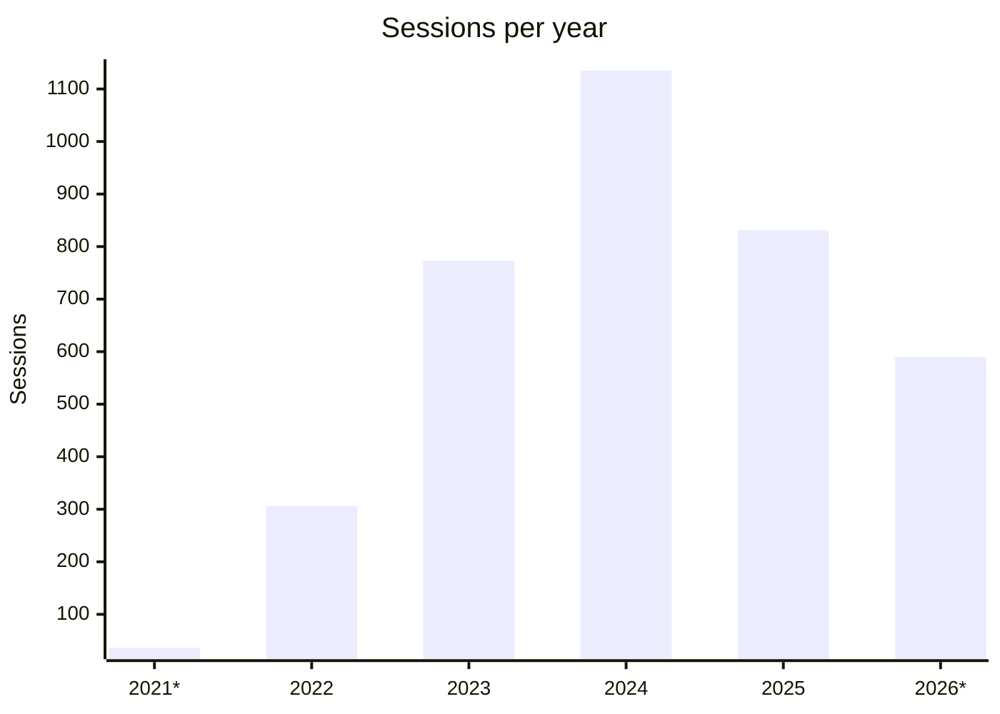

# [[RU](README_RU.md)] Anti-random for [random.org](https://random.org) - Chrome Extension

<p align="center">
  
</p>

## Overview
This extension allows you to falsify results for the random number block on the home page and the list randomizer.

The expansion was created to demonstrate the possibility of skilful manipulation of results for draws, as well as to encourage participants and organizers to pay attention to the use of well-known services, which provide the ability to view the final results to anyone via a link.

## Statistics

Usage data collected with self-hosted [umami](https://umami.is) from November 4, 2021 to November 8, 2026 (extension popup and options pages only).

- **~1,100** installations (unique extension IDs)
- **3,670** sessions
- **45,044** page views



### By year

| Year | Sessions | Active installations | Page views |
|---|---:|---:|---:|
| 2021\* | 36 | 19 | 1,085 |
| 2022 | 306 | 130 | 7,832 |
| 2023 | 773 | 294 | 15,623 |
| 2024 | 1,135 | 401 | 11,762 |
| 2025 | 831 | 264 | 5,604 |
| 2026\* | 590 | 156 | 3,138 |

\* Partial years: 2021 — from November 4, 2026 — up to November 8.

### Audience

Share of all sessions.

**Countries**

| Country | % |
|---|---:|
| USA | 17.1 |
| Vietnam | 13.7 |
| Romania | 12.1 |
| Germany | 11.0 |
| Russia | 10.4 |
| Ukraine | 7.5 |
| Other | 28.2 |

**Browsers**

| Browser | % |
|---|---:|
| Chrome | 79.6 |
| Edge | 16.0 |
| Other | 4.3 |

**Operating systems**

| OS | % |
|---|---:|
| Windows | 77.8 |
| macOS | 19.5 |
| Linux | 1.6 |
| Other | 1.1 |

### Usage

- **2 out of 3** installations (67%) were used for a single day only
- **86%** of result views — random number generator, **14%** — list randomizer

Over five years, about 1,100 people have checked how easy it is to fake a draw result. Don't trust screenshots or screen recordings of a draw — ask for a link to the result on the service itself.

## Donations

- **BTC (Coin)** ```1GJfZSAtkiSgrVRzxSm7UX2n35Drby1dVs```
- **ETH (ERC20)** ```0x8eE9250325BE460f0225d0d745873F3b485a885b```
- **USDT (TRC20)** ```TUQFo52LRWNWa61gtQcbtWMCs3CUPae9Ub```

## Installing from releases

- Download the **anti-random.org-\*.zip** file in the latest available [release](https://github.com/azate/anti-random.org/releases)
- Unzip the archive
- Open your browser and go to the extensions page using this URL ```chrome://extensions```
- Make sure that **Developer mode** is enabled
- Click the **Load unpacked extension** button and select the folder with the unpacked extension

## Using

- Go to extension options
- Add your values for the type of randomizer you want to falsify

### For the random number block

- Go to the [page](https://random.org)
- In the **True Random Number Generator** block, fill in the desired minimum and maximum value
- Click the **Generate** button with the right mouse button
- If there are values you specify for falsification and one of them falls into the range you specify, you will see a falsified result
- After tampering, the value will be deleted to prevent reuse
- In all other cases, a real random will be used

### For the list randomizer

- Go to the [page](https://www.random.org/lists)
- Fill in the field
- Click **Randomize** or **Again!** right mouse button
- If there are values you set for falsification, you will see the falsified result with the replacement of the first elements in the list
- After tampering, the value will be deleted to prevent reuse
- In all other cases, a real random will be used

## FAQ

#### I added the desired results for tampering, but they are not substituted

- Check that the extension is enabled
- Make sure that you right-click on the corresponding button
- Perhaps there have been some changes on the site, and the extension needs updating

#### You can implement additional functionality?

In short, no. The extension was created for demonstration purposes, but if you implement it yourself and create a pull request, I will consider it

#### Is it safe?

The author does not take any responsibility, according to the license. The code is open source, and you can audit it or build it yourself from source without using the analytics that are present in ready-made releases. Analytics were built into the extension popup and options pages and were used to find out audience coverage; no data was sent from random.org pages. Data collection stopped in November 2026 and the analytics server has been shut down

## Local build and installation

### Requirements

- **node** ^20.10
- **pnpm** ^8.11

### Build

- Download the **Source code (zip)** file in the latest available [release](https://github.com/azate/anti-random.org/releases)
- Unzip the archive and go to the folder with the sources
- Use the terminal to run the command ```pnpm install && pnpm run build```
- An archive and folder with extension will appear in the **build** folder

### Installation

- Open your browser and go to the extensions page using this URL ```chrome://extensions```
- Make sure that **Developer mode** is enabled
- Click the **Load unpacked extension** button and select the folder with the extension from the **build** folder
