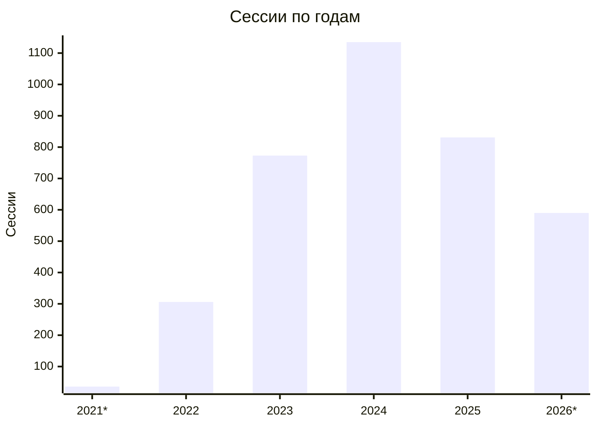

# [[EN](README.md)] Anti-random для [random.org](https://random.org) - Chrome Extension

<p align="center">
  
</p>

## Обозрение
Это расширение позволяет вам фальсифицировать результаты для блока случайных чисел на главной странице и рандомизатора списка.

Расширение создано в целях демонстрации возможности искусного манипулирования результатами для розыгрышей, а также с призывом к участвующим и организаторам обратить внимание на использование общеизвестных сервисов, которые предоставляют возможность просматривать итоговые результаты любому желающему по ссылке.

## Статистика

Данные об использовании собраны с помощью self-hosted [umami](https://umami.is) с 4 ноября 2021 по 8 ноября 2026 года (только popup и страница опций расширения).

- **~1 100** установок (уникальные ID расширения)
- **3 670** сессий
- **45 044** просмотров страниц



### По годам

| Год | Сессии | Активные установки | Просмотры |
|---|---:|---:|---:|
| 2021\* | 36 | 19 | 1 085 |
| 2022 | 306 | 130 | 7 832 |
| 2023 | 773 | 294 | 15 623 |
| 2024 | 1 135 | 401 | 11 762 |
| 2025 | 831 | 264 | 5 604 |
| 2026\* | 590 | 156 | 3 138 |

\* Неполные годы: 2021 — с 4 ноября, 2026 — по 8 ноября.

### Аудитория

Доля от всех сессий.

**Страны**

| Страна | % |
|---|---:|
| США | 17,1 |
| Вьетнам | 13,7 |
| Румыния | 12,1 |
| Германия | 11,0 |
| Россия | 10,4 |
| Украина | 7,5 |
| Другие | 28,2 |

**Браузеры**

| Браузер | % |
|---|---:|
| Chrome | 79,6 |
| Edge | 16,0 |
| Другие | 4,3 |

**Операционные системы**

| ОС | % |
|---|---:|
| Windows | 77,8 |
| macOS | 19,5 |
| Linux | 1,6 |
| Другие | 1,1 |

### Использование

- **2 из 3** установок (67%) использовались всего один день
- **86%** просмотров результатов — генератор случайных чисел, **14%** — рандомизатор списков

За пять лет около 1 100 человек проверили, насколько легко подделать результат розыгрыша. Не доверяйте скриншотам и записям экрана розыгрыша — просите ссылку на результат на самом сервисе.

## Пожертвования

- **BTC (Coin)** ```1GJfZSAtkiSgrVRzxSm7UX2n35Drby1dVs```
- **ETH (ERC20)** ```0x8eE9250325BE460f0225d0d745873F3b485a885b```
- **USDT (TRC20)** ```TUQFo52LRWNWa61gtQcbtWMCs3CUPae9Ub```

## Установка из релизов

- Скачайте в последнем доступном [релизе](https://github.com/azate/anti-random.org/releases) файл **anti-random.org-\*.zip**
- Разархивируйте архив
- Откройте браузер и перейдите на страницу расширений, используя этот URL ```chrome://extensions```
- Убедитесь, что **Режим разработчика** включен
- Нажмите кнопку **Загрузить распакованное расширение** и выберите каталог с разархивированным расширением

## Использование

- Перейдите в опции расширения
- Добавьте для нужного типа рандомизатора ваши значения для фальсификации

### Для блока случайных чисел

- Перейдите на [страницу](https://random.org)
- В блоке **True Random Number Generator** заполните желаемое минимальное и максимальное значение
- Нажмите кнопку **Generate** правой кнопкой мышки
- Если есть заданные вами значения для фальсификации и одно из них попало в указанный вами диапазон, то вы увидите сфальсифицированный результат
- После фальсификации значение будет удалено для предотвращения повторного использования
- Во всех остальных случаях будет использован настоящий рандом

### Для рандомизатора списка

- Перейдите на [страницу](https://www.random.org/lists)
- Заполните поле
- Нажмите кнопку **Randomize** или **Again!** правой кнопкой мышки
- Если есть заданные вами значения для фальсификации, то вы увидите сфальсифицированный результат с заменой первых элементов списка
- После фальсификации значения будут удалены для предотвращения повторного использования
- Во всех остальных случаях будет использован настоящий рандом

## Часто задаваемые вопросы

#### Я добавил желаемые результаты для фальсификации, но они не подставляются

- Проверьте, что расширение включено
- Убедитесь, что вы кликаете правой кнопкой мыши по соответствующей кнопке
- Возможно, на сайте произошли какие-то изменения, и расширение требует обновления

#### Можете реализовать дополнительный функционал?

Если кратко, то нет. Расширение создано в демонстративных целях, но если вы сами реализуете и создадите pull request, я его рассмотрю

#### Это безопасно?

Автор не несет никакой ответственности, согласно лицензии. Код является открытым, и вы можете провести аудит или собрать самим с исходников без использования аналитики, которая присутствует в готовых релизах. Аналитика была встроена в popup и страницу опций расширения и использовалась, чтобы узнать охват аудитории; со страниц random.org данные не отправлялись. В ноябре 2026 года сбор данных прекращён, сервер аналитики отключён

## Локальная сборка и установка

### Требования

- **node** ^20.10
- **pnpm** ^8.11

### Сборка

- Скачайте в последнем доступном [релизе](https://github.com/azate/anti-random.org/releases) файл **Source code (zip)**
- Разархивируйте архив и перейдите в папку с исходниками
- Через терминал выполните команду ```pnpm install && pnpm run build```
- В папке **build** появится архив и папка с расширением

### Установка

- Откройте браузер и перейдите на страницу расширений, используя этот URL ```chrome://extensions```
- Убедитесь, что **Режим разработчика** включен
- Нажмите кнопку **Загрузить распакованное расширение** и выберите папку с расширением из папки **build**
